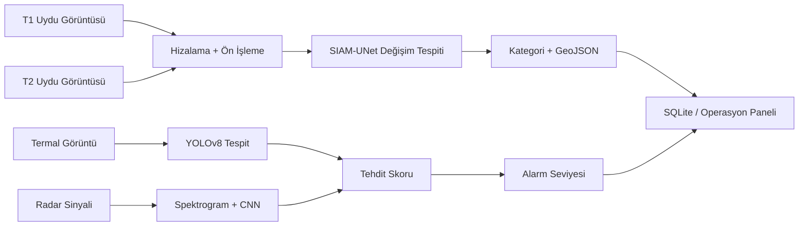
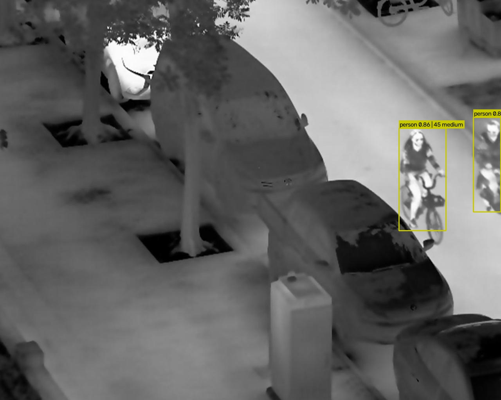
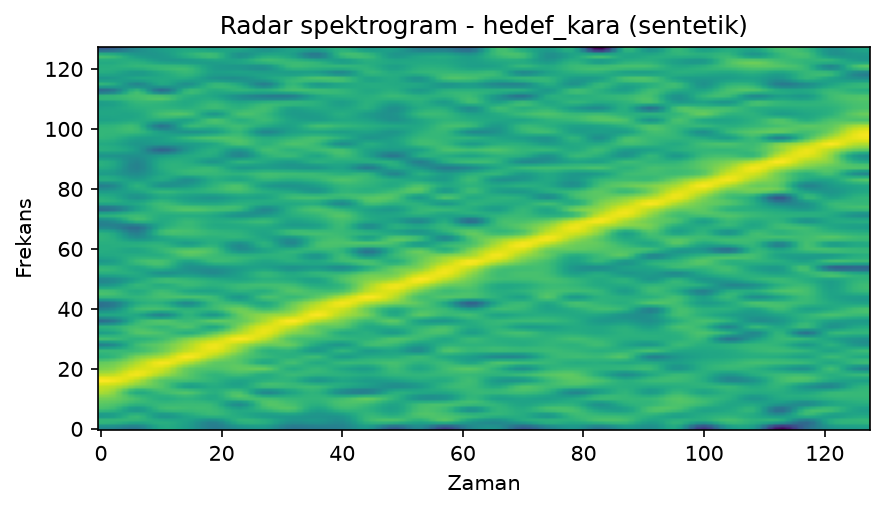
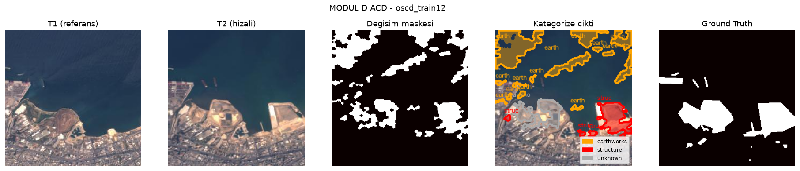
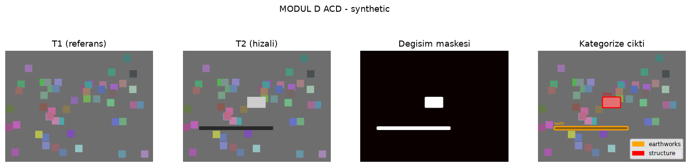

# AI Defense Surveillance

**Çok modlu savunma gözetimi, hedef tespiti ve dinamik tehdit değerlendirme sistemi.**

Bu repo, projenin **tanıtım ve portföy** amacıyla hazırlanmış özetidir. Kaynak kod,
eğitilmiş model ağırlıkları ve veri setleri savunma projesi hassasiyeti nedeniyle
kamuya açık değildir. Detaylı teknik görüşme ve kod incelemesi talep üzerine
yapılabilir.

## Özet

Proje; termal görüntü, radar sinyali ve uydu görüntüsü olmak üzere üç farklı
sensör modalitesini tek bir tehdit değerlendirme hattında birleştirir.

- **Termal görüntüde** YOLOv8 ile person/vehicle tespiti
- **Radar sinyalinde** spektrogram + CNN ile sınıf tahmini
- **Uydu görüntülerinde** iki dönem arası değişim tespiti (SIAM-UNet / FC-Siam-Diff)
- Tespitlerin **0-100 dinamik tehdit skoruna** dönüştürülmesi
- Sonuçların **SQLite**, **GeoJSON** ve **Streamlit operasyon paneli** ile sunulması
- Modeller hazır değilse sistemin otomatik olarak **MOCK** moda düşmesi

## Modüller

| Modül | Görev | Teknoloji |
|---|---|---|
| **A** | Termal hedef tespiti (person, vehicle) | YOLOv8 + PyTorch |
| **B** | Radar sinyali sınıflandırma (hava/kara/deniz/yok) | CNN + STFT spektrogram |
| **C** | Dinamik tehdit skoru (0-100) ve alarm seviyesi | Özgün ağırlıklı formul |
| **D** | Uydu değişim tespiti ve GeoJSON üretimi | SIFT/ORB + SIAM-UNet |

**Tehdit formülü:** `Skor = Sınıf x %40 + Konum x %30 + Davranış x %30`

## Mimari

## Sonuçlar

### Modül A - Termal tespit

| Metrik | Değer |
|---|---|
| mAP50 | **0.8631** |
| mAP50-95 | 0.5751 |
| Precision | 0.9046 |
| Recall | 0.7683 |
| person mAP50 | 0.9108 |
| vehicle mAP50 | 0.8154 |

Eğitim verisi: FLIR ADAS v2 + LLVIP (22.275 train / 4.287 val).

### Modül B - Radar sınıflandırma

Sentetik chirp sinyalleri üzerinde 4 sınıflı CNN. Spektrogram, frekans-zaman
desenini görüntü gibi temsil eder.

### Modül D - Uydu değişim tespiti

OSCD veri seti (172 çift) üzerinde FC-Siam-Diff tarzı SIAM-UNet.

| Yöntem | F1 |
|---|---|
| Kural tabanlı V1 | 0.141 |
| SIAM-UNet V2 | **0.45** |

## Operasyon Paneli

Streamlit tabanlı panel beş bölümden oluşur:

- **Genel Bakış**: model durumu, SQLite özeti, alarm dağılımı ve son koşular
- **Modül A**: termal görüntü yükleme, tespit kutuları ve tehdit skorları
- **Modül B**: WAV yükleme veya sentetik sinyal, spektrogram ve CNN tahmini
- **Modül C**: Modül A tespitlerinden otomatik veya manuel tehdit skoru
- **Modül D**: T1/T2 veya OSCD çifti, hizalama, değişim maskesi, kategori ve GeoJSON indirme

## Teknoloji Yığını

`Python`, `PyTorch`, `Ultralytics YOLOv8`, `OpenCV`, `NumPy`, `SciPy`,
`FastAPI`, `SQLite/aiosqlite`, `Streamlit`, `Matplotlib`

## Kaynak Kodu Neden Paylaşılmadı?

Bu proje savunma sanayi odaklı bir bitirme projesidir. Aşağıdaki nedenlerle tüm
kaynak kod ve model ağırlıkları public repoda yer almaz:

- Eğitilmiş model ağırlıkları ve veri hazırlama hatları hassas kabul edilir.
- Termal, radar ve uydu sensörlerine ait iş akışları kötüye kullanılabilir.
- Kullanılan veri setlerinin lisansları yeniden dağıtıma izin vermeyebilir.
- Savunma projelerinde kaynak kodun erişiminin kontrollü tutulması esastır.

Tam kaynak kod, özel (private) depoda tutulmaktadır. Teknik görüşme, staj/İK
değerlendirmesi veya akademik inceleme için GitHub üzerinden iletişime
geçilebilir.

## Atıflar

- **FLIR ADAS v2** - termal hedef tespiti veri seti
- **LLVIP** - düşük ışıklı termal görüntü veri seti
- **OSCD (Onera Satellite Change Detection)** - uydu değişim tespiti veri seti
- **Ultralytics YOLOv8** - termal nesne tespiti (AGPL-3.0)
- **FC-Siam-Diff / SIAM-UNet (Daudt et al.)** - uydu değişim tespiti yaklaşımı
- **PyTorch, OpenCV, FastAPI, Streamlit** - altyapı ve arayüz

## Lisans

Bu repodaki tanıtım metni ve görseller MIT lisansı ile paylaşılmıştır. Projenin
tam kaynak kodu ve model ağırlıkları bu lisans kapsamında değildir; tüm hakları
saklıdır. Üçüncü taraf veri setleri ve kütüphaneler kendi lisanslarına tabidir.

## İletişim

- GitHub: [@MehmetnC1](https://github.com/MehmetnC1)
- Proje: AI Defense Surveillance
